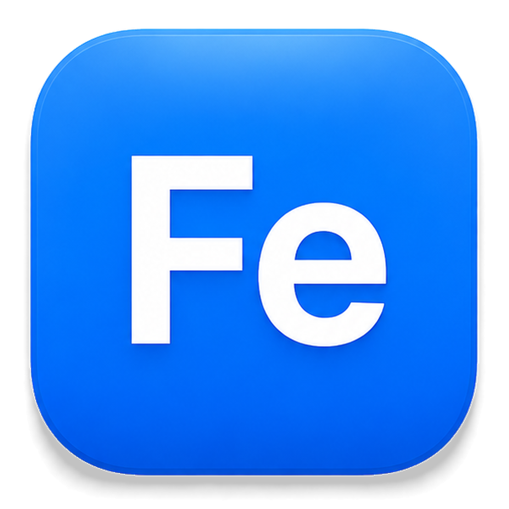
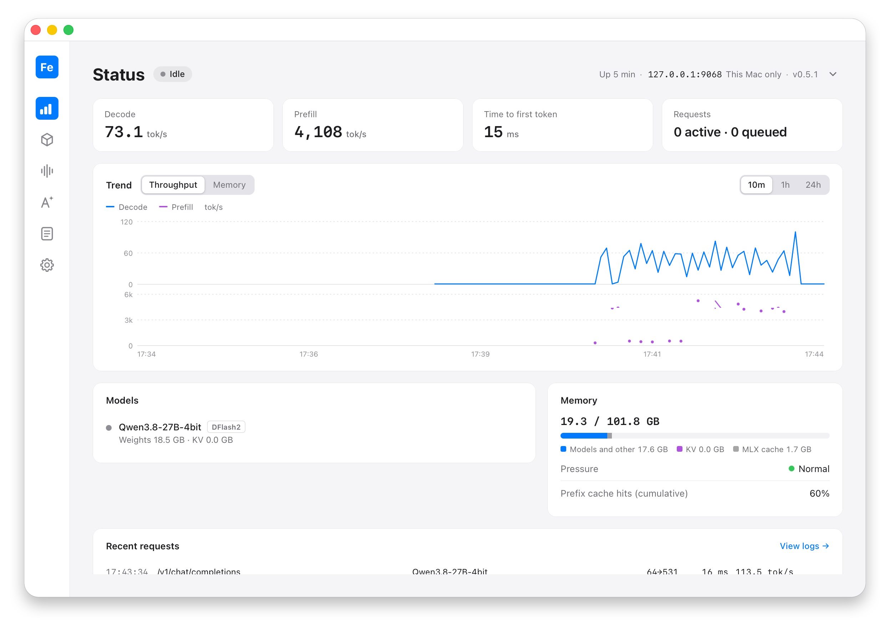

<p align="center">
  
</p>

<h1 align="center">IronMLX</h1>

<p align="center">
  <a href="https://www.rust-lang.org/"></a>
  
  <a href="LICENSE"></a>
</p>

<p align="center">
  <strong>Private AI on Apple Silicon.</strong> Power your Agents with local AI models.
</p>

<p align="center">
  <a href="#install-and-run">Installation</a> ·
  <a href="#performance">Performance</a> ·
  <a href="https://apepkuss.github.io/ironmlx/docs/supported-models.html">Supported Models</a> ·
  <a href="https://apepkuss.github.io/ironmlx/docs/api-reference.html">API Reference</a> ·
  <a href="https://apepkuss.github.io/ironmlx/docs/">Documentation</a> ·
  <a href="https://apepkuss.github.io/ironmlx/">Website</a>
</p>

<p align="center">
  <span lang="en">🇺🇸 English</span> |
  <a href="README.zh-CN.md" lang="zh-Hans">🇨🇳 中文</a>
</p>

<p align="center">
  <picture>
    <source media="(prefers-color-scheme: dark)" srcset="docs/images/dashboard-overview-dark.png">
    
  </picture>
</p>

IronMLX is a macOS App with a local inference server, written in Rust on [MLX](https://github.com/ml-explore/mlx). It runs open models on your Mac and serves them through OpenAI- and Anthropic-compatible APIs, so prompts and outputs stay on the machine.

## Capabilities

- **GUI Dashboard** — Manage models, monitor service status, and adjust settings through a visual interface.

- **Agent integrations** — One-click setup for [OpenCode](docs/opencode.md), [Hermes Agent](docs/hermes-agent.md), [oh-my-pi](docs/oh-my-pi.md), [community DSH Desktop](docs/dsh.md#dsh-desktop-app-configuration), and [official DeepSeek Harness CLI / Desktop](docs/dsh.md#official-deepseek-harness-one-click-setup).

- **Model capabilities** — [Text and vision](docs/text-vision-api.md), [text, image and audio embeddings](docs/text-embeddings.md), [speech synthesis](docs/audio-speech-api.md), [speech recognition](docs/audio-transcriptions-api.md), [image generation](docs/image-generation-api.md), and decision inference through [System One](docs/laya-systemone-api.md) or the [OpenAI Decisions API](docs/openai-decisions-api.md).

- **Model management** — Download models from Hugging Face or ModelScope, [import local models](docs/user-guide.md#import-a-model-already-on-this-mac), and manage multiple models.

- **API compatibility** — [OpenAI- and Anthropic-compatible APIs](docs/api-reference.md) with streaming, tool-call protocols, and Structured Outputs.

- **Inference optimization** — Continuous batching and KV caching, with [MTP, DFlash2, or Assistant](docs/supported-models.md) acceleration for compatible models.

- **Privacy and diagnostics** — Local access by default, optional [LAN authentication](docs/security-boundary.md), and [local redacted diagnostic exports](docs/diagnostic-bundle.md).

## Performance

Built for prefill and decode speed. Measured against other local inference apps on the same Mac, with the test setup and results published in full, including those where IronMLX is not the fastest.

| Model | Short prompts | 30K-token prompts |
| --- | --- | --- |
| Qwen3.8 27B (dense) | [1 request](https://apepkuss.github.io/ironmlx/docs/benchmarks/qwen38-dense-b1-short.html) · [4 concurrent](https://apepkuss.github.io/ironmlx/docs/benchmarks/qwen38-dense-b4-short.html) | [1 request](https://apepkuss.github.io/ironmlx/docs/benchmarks/qwen38-dense-b1-30k.html) · [4 concurrent](https://apepkuss.github.io/ironmlx/docs/benchmarks/qwen38-dense-b4-30k.html) |
| Qwen3.6 35B A3B (MoE) | [1 request](https://apepkuss.github.io/ironmlx/docs/benchmarks/qwen36-moe-b1-short.html) · [4 concurrent](https://apepkuss.github.io/ironmlx/docs/benchmarks/qwen36-moe-b4-short.html) | [1 request](https://apepkuss.github.io/ironmlx/docs/benchmarks/qwen36-moe-b1-30k.html) · [4 concurrent](https://apepkuss.github.io/ironmlx/docs/benchmarks/qwen36-moe-b4-30k.html) |

Long context: [128K- and 256K-token prompts](https://apepkuss.github.io/ironmlx/docs/benchmarks/ironmlx-long-context.html).

## Install and run

Requires Apple Silicon and macOS 26.4 or later. Intel Macs are not supported.

1. **Download** — Get the Apple Silicon DMG or ZIP from [GitHub Releases](https://github.com/apepkuss/ironmlx/releases).
2. **Install and launch** — For a DMG, drag `IronMLX.app` to `Applications`, wait for the copy to finish, eject the disk image, and launch the App from Finder. For a ZIP, extract it and open the App.
3. **Load a model** — In Dashboard, download or import a [compatible model](docs/supported-models.md), then load it.
4. **Connect an Agent or API client (optional)** — Follow [Agent configuration](docs/user-guide.md#agent-configuration) or the [API quick start](docs/developer-guide.md#api-quick-start). The App endpoint defaults to `http://127.0.0.1:9068`.

> [!TIP]
> For complete setup instructions, see the [User guide](docs/user-guide.md#install-and-start).

### Send a first request

Replace `your-model-id` with an ID returned by the first command.

```bash
curl http://127.0.0.1:9068/v1/models

curl http://127.0.0.1:9068/v1/chat/completions \
  -H 'Content-Type: application/json' \
  -d '{"model": "your-model-id", "messages": [{"role": "user", "content": "Hello"}]}'
```

## Development

[Build from source](docs/building-from-source.md) · [Contributing](CONTRIBUTING.md) · [Support](SUPPORT.md) · [Security](SECURITY.md)

## License

- **Source code** — IronMLX original source code is licensed under [Apache License 2.0](LICENSE); see [NOTICE](NOTICE) for attribution.

- **Third-party components** — Dependencies and bundled assets retain their own licenses; see [Third-party notices](THIRD_PARTY_NOTICES.md) and [license texts](THIRD_PARTY_LICENSES/).

- **Model weights** — Model weights are not licensed or redistributed by IronMLX; follow the license and usage terms of their upstream repositories.
