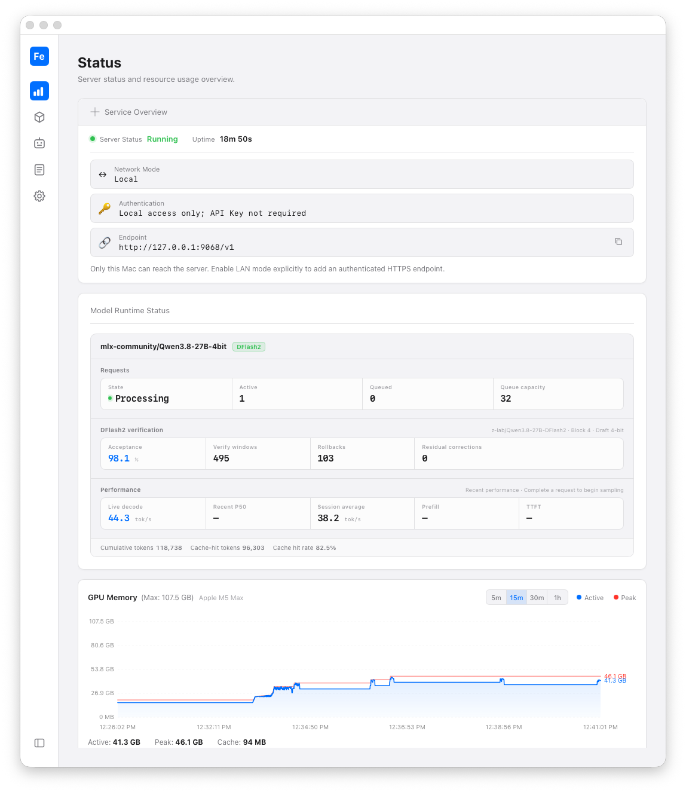

# IronMLX User Guide

[简体中文](zh-CN/user-guide.md)

This guide organizes the user path for the latest public release. It links to
focused reference pages instead of repeating their details.



The status page shows a running local endpoint, the loaded
`mlx-community/Qwen3.8-27B-4bit` model, and its matching DFlash2 draft.

## Install and start

1. Download the latest Apple Silicon DMG or ZIP from the
   [IronMLX GitHub Releases page](https://github.com/apepkuss/ironmlx/releases/latest).
2. Optionally verify the downloaded archive with the `RELEASE-SHA256SUMS`
   file published on the same Release page.
3. If you downloaded the DMG, open it, drag `IronMLX.app` onto the
   `Applications` folder shortcut, and wait for the copy to finish. Close the
   DMG window and eject the disk image.
4. If you downloaded the ZIP, extract it to a local folder.
5. In Finder's Applications folder, find and double-click IronMLX (or open the
   extracted App when using the ZIP). If no model is available yet, the App
   first opens a window that can download a recommended model for
   [chat](#menu-bar-chat).
6. Use the Dashboard to search Hugging Face or ModelScope, download, or load a
   compatible model.
7. Check the service at `http://127.0.0.1:9068/healthz`.

See [supported models](supported-models.md) before downloading a model. Model
architecture support does not guarantee that a particular revision fits your
device memory or satisfies its upstream license terms. Model weights are not
included in the installer and remain subject to the upstream model repository's
license and access terms.

If the health check fails, see [Troubleshooting](troubleshooting.md).

## Menu bar chat

Choose **Chat** from the IronMLX menu bar icon to talk with a local model in a
small window. Chat uses the local service on this Mac and starts it if it is
stopped.

If no chat model has been downloaded, the **No chat model yet** window opens
instead. When a starter model from the catalogue fits this Mac's memory, the
window recommends it. **Download Recommended Model** downloads it from
huggingface.co, or from hf-mirror.com when huggingface.co cannot be reached,
then loads it as the default model. If the window stays open, chat opens when
the model is ready. If you close it or choose **Continue in Background**, the
download keeps running, the menu shows its progress under **Chat**, and
IronMLX asks for permission to notify you when the model is ready.
**Choose a Model Myself** opens **Models → Model Download** in the Dashboard.

Chat uses a loaded chat model, preferring the default model. If none is
loaded, it loads a downloaded one (the default model, otherwise a starter
model, otherwise the smallest) and makes it the default. The model menu at the
top of the window lists downloaded chat models. Switching asks for confirmation,
unloads the current default model unless it is pinned, and loads the new one as
the default; **Manage models…** opens **Models → Model Manager**. Chat does not load or
switch DFlash2 models: while a model runs with DFlash2, chat uses that model,
and switching happens in the Dashboard.

Messages are text, up to 100,000 characters. With a model that can read
images, you can attach up to 4 images per message, each under 20 MB, with the
**Add image** button, by dragging, or by pasting. For models that support
thinking, **Think** turns it on or off and, when the model offers levels,
selects **Low**, **Medium** (the default) or **High**.

**History** lists earlier conversations and **New chat** starts another. Only
the latest 20 conversations are kept, on this Mac; see
[Data locations and uninstall](storage-and-uninstall.md). The
**Connect DeepSeek Harness or another agent →** link in the history panel opens
the Dashboard **Agent** page at the [DeepSeek Harness](dsh.md) guide.

## Download and update models

In **Models → Model Download → Supported models**, browse by type, select a quantization variant, then choose **HuggingFace**. Variants of the same model share a row. Options show format and bit width; selecting one reveals its repository, approximate size, memory hint, and validation status.

The catalogue downloads public repositories without an HF token. ModelScope buttons stay hidden until repository availability and mirror contents are verified. Use the separate HuggingFace / ModelScope tabs for other repositories or credentials.

In the **HuggingFace** tab, **Download via hf-mirror** is off by default. Enable it to search repositories and download models through `https://hf-mirror.com`. Hover over or focus the `?` icon for help. New HF downloads use the selected source; queued and paused tasks retain their source, including after restarting the App. Failures do not switch sources automatically. Sending an HF token to the third-party mirror requires confirmation. Proxy routing still follows your network configuration.

Installed variants show **Downloaded · Check for updates**. Checking only compares repository revisions; **Download update** queues the checked revision after you choose it. IndexTTS keeps the revision pinned by its verified resource profile.

In **Download tasks**, **Pause** retains downloaded data and remains paused after restarting the App. **Resume** uses the recorded snapshot and retained files. Credential-protected tasks may require the token again; tokens are not saved to disk. **Delete** removes unfinished tasks and partial files after confirmation. **Clear** on a completed task keeps the installed model.

Independent model components are downloaded alongside the main weight set, using each component's own index. Breeze and Qwen3-TTS downloads require their audio codec weights even for file-only storage; this does not enable inference support. Optional MTP files declared by the repository are included when available. Older snapshots missing required components are marked incomplete; re-download the same revision to repair them. Matching main weights are verified and reused on filesystems that support cloning, and the old snapshot is retained until the repair is verified. `Verified` describes the selected files and component checks, not runtime support.

## Import a model already on this Mac

In Dashboard, open **Models → Model Manager** and select **Import local model**
at the upper right. Choose the model directory containing `config.json`, weights,
and a tokenizer. For a Hugging Face cache, choose the `snapshots/<commit>`
directory rather than its parent cache directory. Review the source, destination,
and copy size before starting. IronMLX copies and verifies the snapshot, then adds
it to the model list. The original directory remains untouched.

Snapshots with a valid IronMLX manifest retain their repository identity. Other
local folders are stored under `~/.ironmlx/models/standalone/`. Importing needs
enough free space for a complete copy. After import, use the ID shown in the model
list to load and manage it. Some model families also need additional runtime
resources prepared before loading.

## Load progress and cancellation

Loading a model from the Dashboard opens a progress panel that lists the load
stages, such as **Read weights** and **Warm up**, with the bytes read, the elapsed
time and an estimate of the time left. **Continue in Background** closes the
panel. The load keeps running when you switch pages or close and reopen the
Dashboard, and the sidebar shows its progress, such as **Loading · 42%**. Other
loads, such as reloads, appear there too; select the sidebar indicator to open
the panel.

**Cancel Load** stops a load. Cancelling a new load releases its memory, and
cancelling a reload keeps the version that is loaded now. Cancelling a switch to
DFlash2 restores the previous configuration and loads the earlier models again.
If you cancel the DFlash2 model that the App restores at startup, the backend
restarts in normal mode with no models loaded; the model's DFlash2 setting is
kept, so you can load it with DFlash2 again later.

## Weight format labels

In the App's **Model Management** list, quantized checkpoints display their
detected quantization format or bit width. Unquantized checkpoints display the
detected weight data type, such as `FP16` or `BF16`; the tooltip identifies the
checkpoint as unquantized and includes the normalized `dtype`. If neither model
metadata nor safetensors headers provide a usable value, the column displays
**Unknown**. These labels describe stored weights, not runtime compute precision.

## First API request

With `mlx-community/Qwen3.8-27B-4bit` loaded, verify a complete local
Responses request:

```bash
curl -fsS http://127.0.0.1:9068/v1/responses \
  -H 'Content-Type: application/json' \
  -d '{"model":"mlx-community/Qwen3.8-27B-4bit","input":"Reply with exactly IRONMLX_OK.","store":false,"max_output_tokens":16,"temperature":0,"stream":false}'
```

The completed response should contain `IRONMLX_OK`. Replace the model ID with
the exact ID shown by `GET /v1/models` when using another loaded model. The
current RC validation also exposes DFlash2 for this model with the matching
`z-lab/Qwen3.8-27B-DFlash2` draft; acceleration details and limitations are in
the [supported models](supported-models.md).

## Agent configuration

Use IronMLX as an Agent's local inference backend and choose the configuration guide for your application.

| Agent | Configuration |
| --- | --- |
| [Hermes Agent](hermes-agent.md) | Local Responses service |
| [OpenCode](opencode.md) | One-click CLI / Desktop setup with native Chat Completions and supported model reasoning variants |
| [oh-my-pi](oh-my-pi.md) | Local OpenAI-compatible service |
| [DeepSeek Harness (DSH)](dsh.md) | [Desktop App](dsh.md#dsh-desktop-app-configuration) or [CLI](dsh.md#dsh-cli-configuration) |

## Speech synthesis

### Voices

With a speech model loaded, open Dashboard **Voices**, import reference audio,
and assign a stable voice ID. Use that ID in the `voice` field when calling the
[speech API](audio-speech-api.md); alternatively, supply reference audio directly
through `ref_audio` in a request. OpenAI-compatible clients can discover enabled
voices through `GET /v1/audio/voices`.

The Dashboard previews the reference recording saved in a voice profile.
Synthesized audio is played by the caller or the
[standalone example client](../examples/speech-client.swift). Voice profiles are
saved under `~/.ironmlx/audio/voices/`; changing the display name preserves the
voice ID. Request fields and WAV/PCM examples are in the [speech API](audio-speech-api.md).

### Resource readiness

The App prepares speech resources automatically. If the model list reports that
resources are missing, choose **Prepare resources**. Retry after an interruption;
verified model files and cached resources are reused. Initial preparation needs
network access; once the complete resources are ready, synthesis can run offline.
The App saves the resource configuration and restores previously loaded or pinned
models after restart.

### Model settings

In **Model Management**, select the gear button for the speech model. Basic model
information is read-only; configuration-backed fields appear only when the model
files provide valid values.

The same window provides six editable runtime policies. Use the defaults and
allowed ranges shown in the settings window.

| Setting | Default | Allowed range and behavior |
| --- | --- | --- |
| Queue timeout | 60 seconds | Positive, at most 24 hours; limits waiting for an execution permit |
| First audio timeout | 120 seconds | Positive, at most 24 hours; starts after the request obtains an execution permit |
| Execution timeout | 900 seconds | Positive, at most 24 hours; starts after the request obtains an execution permit |
| Slow consumer timeout | 30 seconds | Positive, at most 24 hours; limits how long output can remain blocked by the consumer |
| Max output duration | 600 seconds | Positive, up to the runtime profile maximum; includes silence between segments |
| Segment tokens | 120 | Integer from 6 through 120; token budget for each synthesis segment |

If the execution profile is unavailable, these controls and the save action stay
disabled. Saving stores the policies for that model. If the model is loaded, the
App applies them by reloading it after active work becomes idle; the saved values
are also used for later loads and restart recovery. These settings are service
policies, not model limits or latency guarantees. See the [speech API](audio-speech-api.md)
for the corresponding `audio.execution` fields and scheduling semantics.

## Choose a task

- [Embedding API](text-embeddings.md) — EmbeddingGemma 2 BF16/affine4 input formats, limits and Dashboard vector metrics.
- [Laya decision API](laya-systemone-api.md) — load Laya in the App and connect external TypeSafe clients.
- [OpenAI Decisions API](openai-decisions-api.md) — call Laya with the official OpenAI SDK.
- [Supported models](supported-models.md) — model names, types, weight formats,
  capabilities, and acceleration options.
- [Developer guide](developer-guide.md) — API quick start, CLI configuration,
  source development, and contribution resources.
- [Text and vision API](text-vision-api.md) — request fields,
  streaming, structured outputs, reasoning, images, and errors.

## Privacy, security, and local data

- [Privacy and network boundary](privacy.md)
- [Security boundary](security-boundary.md)
- [Data locations and uninstall](storage-and-uninstall.md)
- [Diagnostic export](diagnostic-bundle.md)
- [Automatic updates](automatic-updates.md)
- [Model rights boundary](model-license-boundary.md)

## CLI and advanced configuration

- [DFlash2 configuration and usage](dflash2-server-api.md)
- [Qwen MTP configuration and usage](mtp-server-api.md)
- [CLI multi-model serving (EnginePool)](engine-pool.md)
- [Scheduler performance calibration](scheduler-profile-v5.md)

## Troubleshooting and release context

- [Troubleshooting](troubleshooting.md)
- [Known issues](known-issues.md)
- [0.3.0 release notes](release-notes/0.3.0.md)
- [0.2.0 release notes](release-notes/0.2.0.md)
- [0.1.0 release notes](release-notes/0.1.0.md)

For source builds, tests, contributions, and release engineering, start with
[Building from source](building-from-source.md) and [Contributing](../CONTRIBUTING.md).
